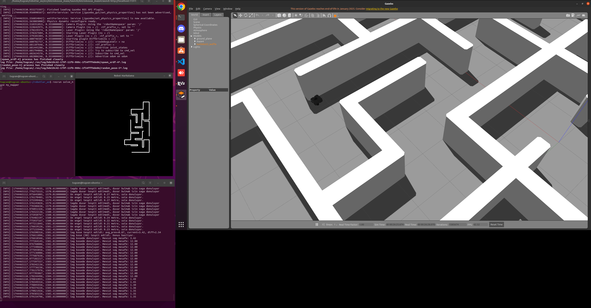
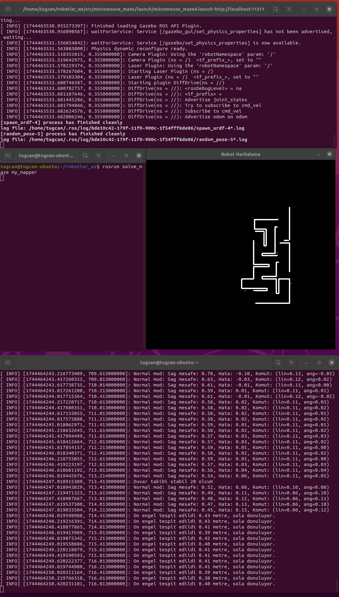
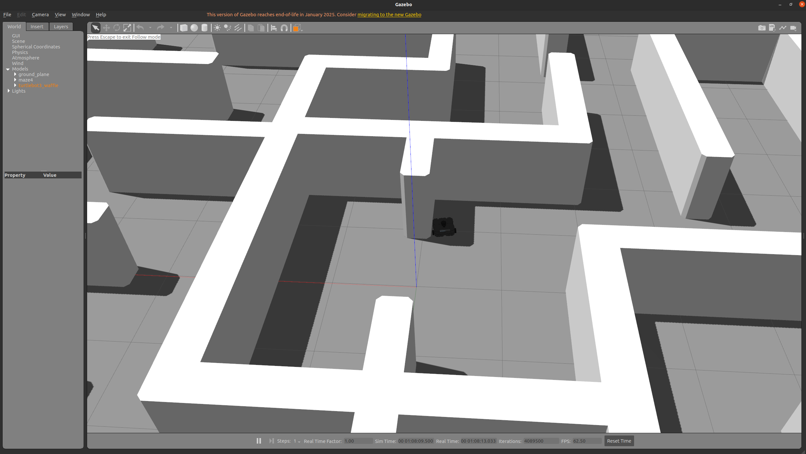
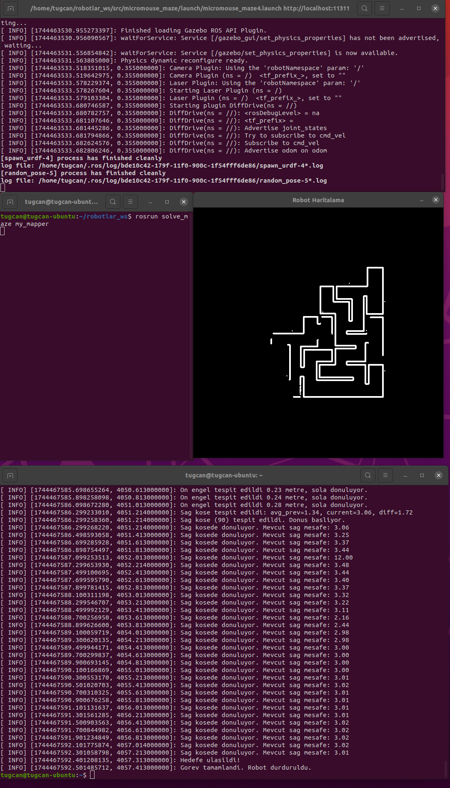
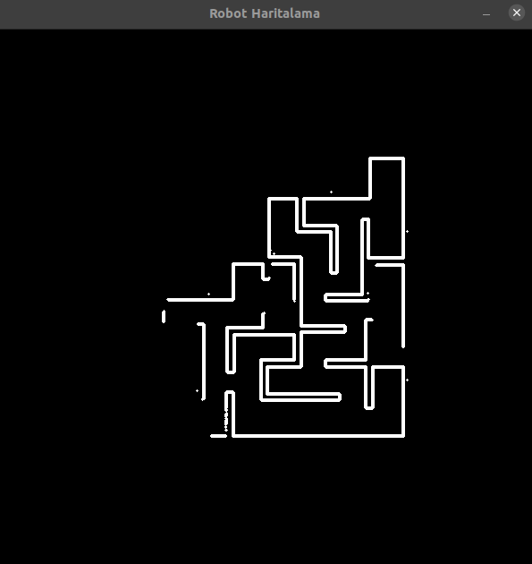
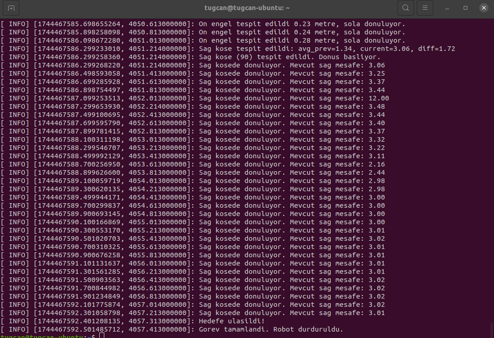

# TurtleBot3 Micromouse Maze Solver and Mapper

ROS1 Noetic C++ coursework for right-wall following and plotting laser returns in a micromouse maze. The original experiment used maze 4 and the TurtleBot3 waffle model.

The maintained source is `robotlar_ws/src/solve_maze`. The tracked `build` and `devel` trees are snapshots from the original Linux workspace, with machine-specific paths and binaries. Build the package in a fresh workspace instead of sourcing those snapshots. The tracked workspace `src/CMakeLists.txt` contains the original catkin path rather than a portable top-level build file.

## Requirements and build

Use a Linux ROS1 Noetic environment with catkin, `roscpp`, `sensor_msgs`, `nav_msgs`, `geometry_msgs`, `tf`, and OpenCV 4. Gazebo, TurtleBot3 and the course's `micromouse_maze` package are separate simulation dependencies; their sources are not included in this checkout. The original assignment repository is [hw1 on GitLab](https://gitlab.com/blm6191_2425b_tai/members/24501118/hw1).

```bash
source /opt/ros/noetic/setup.bash
git clone https://github.com/tugcantopaloglu/micromouse-maze-solver-and-mapper-ros.git
mkdir -p ~/micromouse_ws/src
cp -R micromouse-maze-solver-and-mapper-ros/robotlar_ws/src/solve_maze ~/micromouse_ws/src/
cd ~/micromouse_ws
rosdep install --from-paths src --ignore-src -r -y
catkin_make
source devel/setup.bash
export TURTLEBOT3_MODEL=waffle
```

Ensure the simulation packages are installed in this workspace or in a sourced underlay. Run the simulator as a regular desktop user:

```bash
roslaunch micromouse_maze micromouse_maze4.launch
```

## Run

In separately sourced terminals, start one wall-following solver and optionally the mapper:

```bash
rosrun solve_maze my_solver
```

Alternatively, use the original oscillating controller:

```bash
rosrun solve_maze my_solver_salinimli
```

Display mapped laser returns:

```bash
rosrun solve_maze my_mapper
```

Both solvers subscribe to `/scan` and `/odom` and publish `/cmd_vel`. Run only one solver at a time. They stop when odometry enters the original goal region `abs(x) < 1` and `abs(y) < 1`; this assumes the simulator's odometry origin matches that goal. Angular indexing supports full scans starting at zero or at a negative angle. Empty scans, invalid angular metadata, and scans missing a required direction produce a stop command. NaN and negative wall readings are treated as blocked, while positive infinity is capped at the configured maximum range.

The mapper transforms finite laser returns from the scan frame into `odom` and displays a 600 by 600 OpenCV image at 20 pixels per meter. It requires TF and a graphical display. It draws observed endpoints; it does not publish a ROS occupancy grid or implement SLAM. Returns outside the image are ignored.

## Regression checks and limits

The standalone C++ test covers scan angle wrapping, missing directions, malformed scan geometry, invalid readings, and safe image-coordinate conversion:

```bash
g++ -std=c++11 -Wall -Wextra -Werror robotlar_ws/src/solve_maze/test/scan_math_test.cpp -o /tmp/scan_math_test
/tmp/scan_math_test
```

In a built catkin workspace, run `ctest --test-dir build -R scan_math_test --output-on-failure`. The isolated test does not validate ROS callbacks, TF, OpenCV display, Gazebo navigation or real hardware. Full acceptance requires the original maze world and a ROS/Gazebo run. ROS1 Noetic is the preserved architecture.

## Original assignment screenshots

These images record the original experiment and are not results from the isolated regression test.







